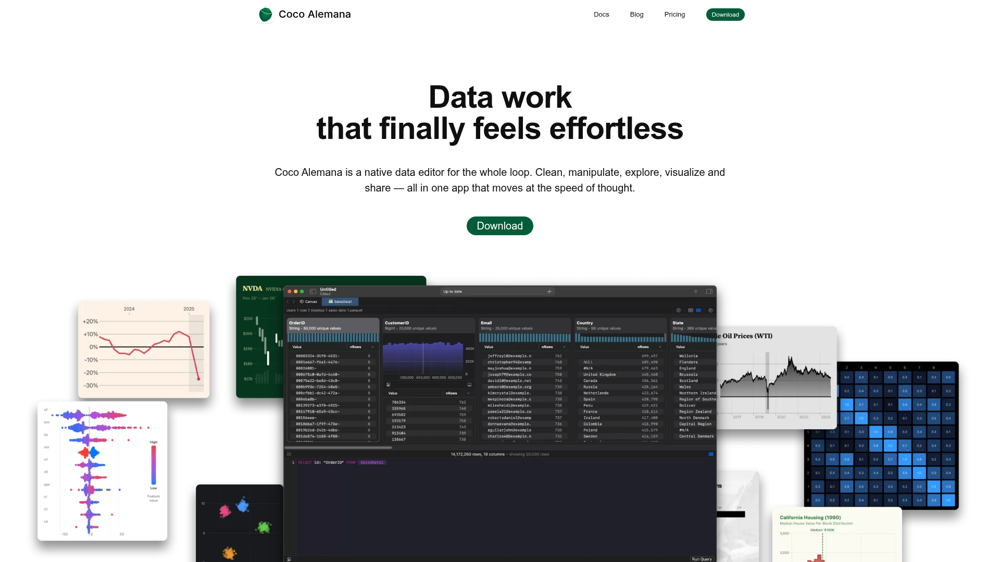

# Coco Alemana inspired direction

## Source

- URL: https://www.cocoalemana.com/
- Capture date: 2026-09-30
- Evidence: Firecrawl branding and images scrape, page markdown, and full page screenshot in `./.firecrawl/`.
- The source screenshot is for visual reference only. This prototype uses no Coco Alemana branding, copy, or images.

## Reference screenshot



## Design summary

An airy, white product page puts a compact navigation above a centered, oversized headline and one green pill action. A layered product collage carries the visual weight: a dark, detailed application window sits in front of floating chart panels. Sections below explain the product in calm, short blocks. The PTE version keeps this page structure and uses a Practice Hub interface in the hero collage.

## Design tokens

### Colors

| Role | Value | Evidence |
| --- | --- | --- |
| White canvas | `#FFFFFF` | Firecrawl branding scrape |
| Near black text | `#0F0F0F` | Firecrawl branding scrape |
| Forest CTA | `#015C3A` | Firecrawl branding scrape |
| Green accent | `#018A55` | Firecrawl branding scrape |
| Blue slate | `#2F434B` | Firecrawl branding scrape |
| Light neutral | `#F3F3F3` | Firecrawl branding scrape |
| Mid border | `#B9B9B9` | Firecrawl branding scrape |
| Product canvas | `#171B1D` | Approximation from screenshot |

### Typography

- Observed family: SF Pro Display with Apple system fallbacks.
- The extracted hero is 60px, black, and centered; body copy is 14px.
- Keep headings strong and compact. Let UI details be denser than the surrounding page.

### Spacing and layout

- Spacing base: 4px, extracted by Firecrawl.
- Page: compact horizontal navigation, broad centered hero, oversized product collage, then alternating feature explanations.
- Extracted default radius: 10px; primary CTA radius: 30px; secondary button radius: 8px.
- Keep the white page open and unboxed. Use shadows only to separate the overlapping product panels.

## Components and page pattern

1. Compact top navigation with a single pill CTA.
2. Centered, two line benefit headline, short supporting text, one primary action.
3. Layered application screenshot treatment: dark central product view with smaller floating data panels.
4. Short product explanation sections with meaningful interface detail rather than repeated generic cards.
5. Quiet footer with product and legal navigation.

## PTE adaptation

- Product audience: PTE Academic learners. Main job: choose and start focused practice.
- Preserve the selected Practice Hub information architecture: Overview, Practice, Mock tests, Progress.
- User selected a blue and white palette for the local mock: primary `#1756B0`, supporting blue `#2F6FDA`, light canvas `#FFFFFF`, and cool gray borders. The source site uses green; this is an intentional product palette override.
- Use original PTE sample data and CSS drawn interface elements. Mark score examples as illustrative.
- Keep interactions local to the prototype; do not imply that test scoring or recording is connected.

## Build instructions

Use the source page's white shell, centered headline, dark interface collage, blue action, restrained borders, and generous whitespace. Adapt the content and interface for PTE learners; do not reproduce Coco's exact layout details, artwork, trademark, or copy.

## Rerun inputs

```yaml
workflow: firecrawl-website-design-clone
source_url: https://www.cocoalemana.com/
target_stack: standalone HTML, CSS, and JavaScript
output: design-lab/coco/DESIGN.md and design-lab/coco/index.html
```
